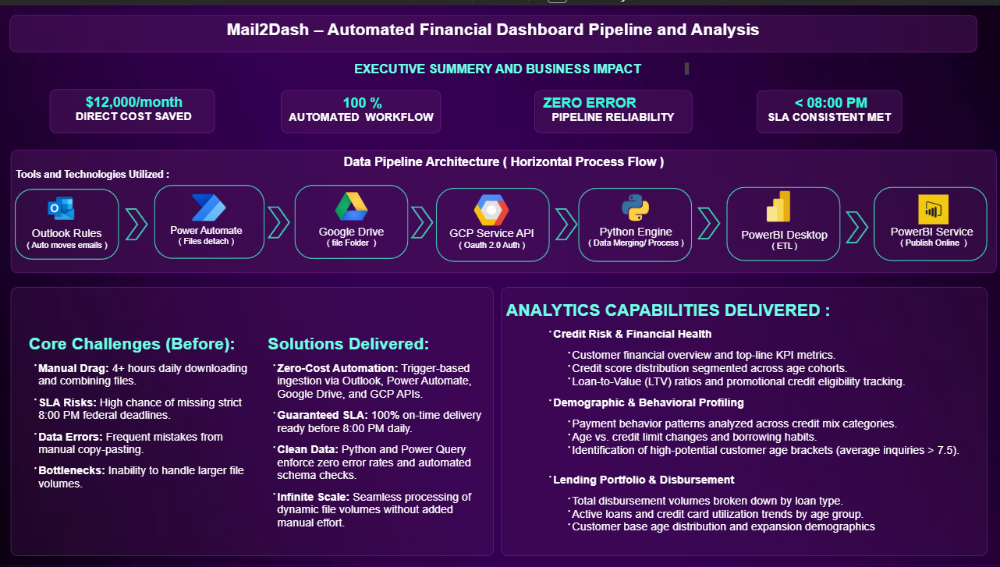
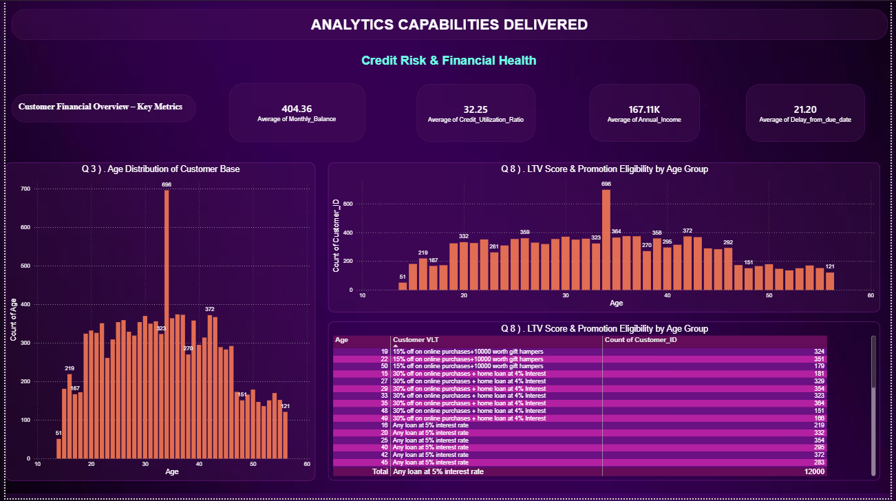
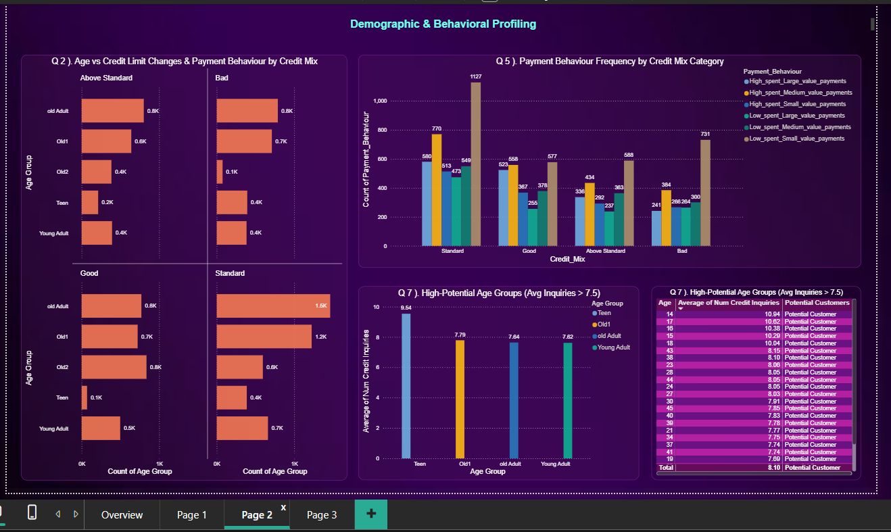
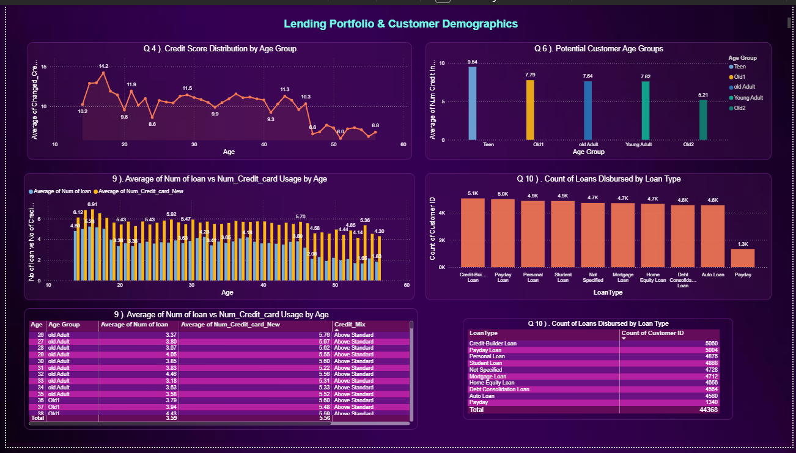

# Mail2Dash - Automated Financial Dashboard Pipeline and Analysis

> An end-to-end automated financial analytics pipeline that transforms raw daily email files into an interactive Power BI dashboard — eliminating manual ETL, reducing costs, and delivering actionable insights for a US government client.

---

## 📋 Table of Contents

- [Project Summary](#-project-summary)
- [Problem Statement](#-problem-statement)
- [Solution Overview](#-solution-overview)
- [Tools & Technologies](#-tools--technologies)
- [Key Contributions](#-key-contributions)
- [Challenges Faced](#-challenges-faced)
- [Solutions Implemented](#-solutions-implemented)
- [Impact](#-impact)
- [Project Architecture](#-project-architecture)
- [Dashboard Preview](#-dashboard-preview)
- [Repository Structure](#-repository-structure)
- [Links](#-links)
- [Key Takeaways](#-key-takeaways)

---

## 📌 Project Summary

A financial analytics team supporting the **US government** was struggling with a manual, error-prone daily workflow. Every day at ~3 PM, they received **25+ files via email** from field survey agents across different locations. These files had to be processed and turned into a comprehensive dashboard by **8 PM the same day**.

Despite hiring **two additional employees at $12,000/month**, the team faced persistent delays, high error rates, and workload spillover affecting other projects. They needed a way to **reduce time, minimize errors, cut costs, and streamline the workload**.

This project delivers an **end-to-end automated financial analytics pipeline** that:

- ✅ Automatically ingests 25+ daily files from email and Google Drive
- ✅ Consolidates data using Python (`pandas`)
- ✅ Cleans and transforms data using Power Query (M Language)
- ✅ Delivers an interactive Power BI dashboard answering **10+ business questions**
- ✅ Eliminates manual effort, reduces costs, and improves accuracy

---

## ❗ Problem Statement

| Challenge | Detail |
|-----------|--------|
| **Volume** | ~25 files received daily via email from field agents |
| **Deadline** | Dashboard must be delivered by 8 PM the same day |
| **Manual Steps** | Download → Combine → Clean → Build Dashboard → Share Insights |
| **Cost Overrun** | 2 additional hires at **$12,000/month** — still facing delays |
| **Error Rate** | Frequent data manipulation errors causing delays and inaccuracy |
| **Workload Spillover** | Burden negatively impacting other projects and team efficiency |

---

## 💡 Solution Overview

An **automated financial analytics pipeline** was designed and delivered:

1. **Automated Ingestion** — Outlook rules + Power Automate + Google Drive API
2. **Consolidation** — Python (`pandas.concat()`) merges all files into a single `combined_df`
3. **Cleaning & Transformation** — Power Query (M Language) handles age groups, loan splitting, and data cleaning
4. **Advanced Analytics** — DAX measures for LTV scoring, promotion assignment, and dynamic "Data Missing" handling
5. **Interactive Dashboard** — Power BI delivers 10+ business insights on demographics, payment behavior, credit mix, and loan distribution

---

## 🛠 Tools & Technologies

| Tool | Purpose | Why This Tool? |
|------|---------|----------------|
| **Microsoft Outlook** | Source system for daily file arrivals | No change needed on sender side; frictionless adoption |
| **Power Automate** | Trigger-based email detection and file routing | Native Outlook integration; low-code; reliable scheduled execution |
| **Google Cloud Platform (GCP)** | Centralized data lake and folder structure | Secure, centralized storage accessible by Python and Power BI |
| **Google Drive API (Python)** | Programmatic file retrieval | Service-account auth; downloads 25+ files without manual intervention |
| **Python (pandas)** | File download, concatenation, consolidation | Fast batch operations; `concat()` merges CSVs/Excel seamlessly |
| **Power Query (M Language)** | Data cleaning, custom columns, loan splitting | Load-time transformations improve performance vs. DAX calculated columns |
| **DAX** | Advanced measures: LTV, promotions, dynamic missing-data handling | Dynamic aggregation recalculates based on filter context |
| **Power BI** | Interactive dashboard and final delivery | Industry-standard BI tool; rich visuals; publishable to Power BI Service |

### Why This Tool Stack?

- **Automation-first:** Outlook → Power Automate → GCP → Python eliminates all manual downloading
- **Performance-optimized:** Heavy transformations done in Power Query (load-time) rather than DAX (query-time)
- **Client-safe:** "Data Missing" placeholders preserved in source; DAX measures handle them dynamically
- **Scalable & maintainable:** Each tool handles what it does best; pipeline grows with data volume

---

## 🚀 Key Contributions

### 3.1 ETL Automation

- Designed automated pipeline: **Outlook rules → Power Automate → Google Drive (GCP) → Python (Google Drive API)**
- Python script authenticates via service account, lists all files, handles Google Sheets (exported as CSV), standard CSVs, and Excel files (openpyxl)
- All 25+ daily files downloaded and concatenated into a single `combined_df` DataFrame — **zero manual effort**

### 3.2 Data Cleaning & Transformation

- Cleaned messy financial dataset: fixed garbage values, outliers, inconsistent formats
- Recalculated missing columns using logical assumptions
- **Power Query (M Language):**
  - Created custom **Age Groups** (`Teen`, `Young Adult`, `Old Adult`, `Old 1`, `Old 2`) via conditional logic — done at load time for performance
  - Split comma-separated **Type of Loan** values into individual rows for accurate loan-popularity analysis
  - Replaced "and" delimiters, trimmed spaces, filtered blanks

### 3.3 Advanced DAX Measures

- **Dynamic "Data Missing" handling:**
  ```dax
  Average Credit Inquiries =
  AVERAGEX(
      FILTER(
          'Combine DF',
          NOT(ISERROR(VALUE('Combine DF'[Number of Credit Inquiries])))
      ),
      VALUE('Combine DF'[Number of Credit Inquiries])
  )


* **LTV Scoring Model:**
```
LTV = (0.3 × Avg Annual Income) − (0.15 × Avg Delay from Due Date)
      + (0.4 × Avg Credit Score) + (0.075 × Avg Amount Invested)
      + (0.075 × Avg Monthly Balance)

```


with credit score mapped via `SWITCH` (Good=3, Above Standard=2, Standard=1, Bad=0)
* **Promotion Assignment:** Nested `IF` logic based on LTV thresholds (>80K, 60–80K, 50–60K)
* **Potential Customer Flagging:** `IF([AvgInquiries] > 7.5, "Potential Customer", BLANK())`

### 3.4 Dashboard Delivery

* Built interactive Power BI dashboard answering **10+ business questions**, including:
* Key metric cards (avg income, monthly balance, payment delays, credit utilization)
* Age vs. Change in Credit Limit (line chart, using Average to normalize)
* Age distribution (clustered column chart / histogram approximation)
* Age Groups × Credit Mix (clustered bar chart)
* Payment Behavior by Credit Mix
* Potential customer age groups (average credit inquiries > 7.5)
* LTV scores & promotional offers by age
* Average loans & credit cards by age (dual-series line chart)
* Loan type popularity (after splitting comma-separated values)


* Applied consistent formatting: titles, axis labels, data labels, background styling, format painter

---

## ⚠️ Challenges Faced

| Challenge | Detail |
| --- | --- |
| **Manual, time-consuming ETL** | Downloading, combining, cleaning 25+ daily files consumed hours; 2 additional hires still couldn't keep up |
| **High error rate** | Manual data manipulation introduced frequent errors, impacting accuracy and causing rework |
| **"Data Missing" placeholders** | Client required these text values to remain unchanged — couldn't convert to numeric or replace with NULL |
| **Unequal age intervals** | Age groups had unequal ranges (5, 6, 10, 10, open-ended) — standard bins/grouping wouldn't work |
| **Comma-separated loan types** | `Type of Loan` column contained multiple values per customer (e.g., "Payday, Personal, and Auto") — needed row-level splitting |
| **Cost pressure** | $12,000/month additional labor cost needed to be eliminated or justified |
| **Workload spillover** | Daily grind negatively affecting other projects and team efficiency |

---

## ✅ Solutions Implemented

| Challenge | Solution |
| --- | --- |
| Manual ETL | **Automated pipeline:** Outlook → Power Automate → GCP/Google Drive → Python (Google Drive API) → `pandas.concat()` |
| "Data Missing" handling | **DAX measure:** `AVERAGEX(FILTER(table, NOT(ISERROR(VALUE(column)))), VALUE(column))` — filters out conversion errors at query time, preserves source text |
| Unequal age intervals | **Power Query custom column** using `if...then...else if...else` logic — evaluated once per row at load time (faster than DAX calculated column) |
| Comma-separated loan types | **Power Query:** Split Column by Delimiter → Split into Rows; clean "and"/spaces; count distinct customers per loan type |
| Age vs. credit limit bias | Used **Average** (not Sum) on Y-axis to normalize across ages with varying record counts |
| LTV calculation | **DAX variables + `CALCULATE` + `AVERAGEX` + `SWITCH**` — modular, readable, respects filter context |
| Potential customer identification | **DAX flag measure** with `VAR` / `RETURN` / `IF` — dynamic per-row context in table visual |
| Cost & workload | Automation eliminated manual downloading/combining; Power Query handled cleaning — reducing need for additional hires and freeing team capacity |

---

## 📈 Impact

| Area | Before | After |
| --- | --- | --- |
| **Daily file collection** | Manual download of 25+ email attachments | Fully automated via Outlook → Power Automate → Python pipeline |
| **Data consolidation** | Manual merging, error-prone | `pandas.concat()` — single `combined_df` in seconds |
| **Data cleaning** | Manual fixes, inconsistent | Power Query (M Language) — repeatable, documented, load-time |
| **Dashboard build** | Delayed by upstream manual work | Data ready earlier; dashboard delivered on time by 8 PM |
| **Cost** | $12,000/month extra labor | Potential elimination of additional hires; pipeline runs unattended |
| **Error rate** | High (manual manipulation) | Significantly reduced (automated, rule-based cleaning) |
| **Team workload** | Spillover affecting other projects | Freed capacity; other projects no longer negatively impacted |
| **Client insight** | Static, delayed reporting | Interactive Power BI dashboard with 10+ business questions answered |

---

## 🏗 Project Architecture

```
┌─────────────┐     ┌──────────────────┐     ┌─────────────────────┐
│   Outlook   │────▶│  Power Automate  │────▶│  Google Drive (GCP) │ 
│ (25+ files) │     │ (trigger + route)│     │  (central folder)   │
└─────────────┘     └──────────────────┘     └──────────┬──────────┘
                                                        │
                                                        ▼
                                             ┌─────────────────────┐
                                             │  Python (pandas)    │
                                             │  Google Drive API   │
                                             │  → combined_df      │
                                             └──────────┬──────────┘
                                                        │
                                                        ▼
                                             ┌─────────────────────┐
                                             │  Power Query (M)    │
                                             │  Cleaning + Age     │
                                             │  Groups + Loan Split│
                                             └──────────┬──────────┘
                                                        │
                                                        ▼
                                             ┌─────────────────────┐
                                             │  Power BI + DAX     │
                                             │  LTV, Promotions,   │
                                             │  Dynamic Measures   │
                                             └──────────┬──────────┘
                                                        │
                                                        ▼
                                             ┌─────────────────────┐
                                             │  US Government      │
                                             │  Client Dashboard   │
                                             └─────────────────────┘

```

---

## 🖼 Dashboard Preview










---

## 📁 Repository Structure

```
## 📁 Repository Structure

```text
Financial_pipeline_powerbi_26/
│
├── 📂 assets/
│   ├── Page_01.png                      # Dashboard page 1 screenshot
│   ├── Page_02.png                      # Dashboard page 2 screenshot
│   ├── Page_03.png                      # Dashboard page 3 screenshot
│   └── dashboard_overview.png           # Main dashboard overview image
│
├── 📂 dashboard/
│   └── Financial Project.pbix           # Core Power BI report file
│
├── 📂 data/                             # Directory for raw and processed datasets
│
├── 📂 scr/
│   ├── 📂 dax/
│   │   ├── LoanTypeTable.dax            # DAX measures for loan types
│   │   ├── Potential_Customers.dax      # DAX logic for identifying prospects
│   │   ├── averageLoan.dax              # DAX measures for average loan amounts
│   │   └── custome_VLT.dax              # DAX measures for customer LTV
│   │
│   ├── 📂 power_query/
│   │   ├── Power_query_steps_01.png     # Power Query (M logic) documentation
│   │   ├── power_query_stepts_02.png
│   │   ├── power_query_steps_03.png
│   │   └── power_query_steps_04.png
│   │
│   └── 📂 python/
│       └── drive_combine_pipeline.ipynb # Jupyter notebook for ETL and file combination
│
└── README.md                            # Main project documentation file
```

---

## 🔗 Links

| Resource | Link |
| --- | --- |
| 📊 **Power BI Dashboard** | [View Dashboard](https://app.powerbi.com/groups/me/reports/1a30b8e5-8981-4534-8236-717ca2b0fd0f?ctid=95cd5fc7-eedf-4dcd-8986-48528f05d39f&pbi_source=linkShare&bookmarkGuid=da27139e-f350-4acb-a32c-b5f40a0b4e3b) |
| 🐍 **Python ETL Script** | [Insert GitHub/Gist link](#) |
| 📁 **Sample Dataset** | [Insert link to sanitized sample data](#) |
| 📝 **Project Notes (DAX/Power Query)** | [Insert link to documentation](#) |

---

## 🎯 Key Takeaways

* Built an **end-to-end automated financial analytics pipeline** for a US government client — replacing a manual, error-prone daily workflow (25+ email files, $12K/month extra labor)
* Automated the flow: **Outlook → Power Automate → GCP → Python → Power BI**
* Delivered an **interactive dashboard answering 10+ business questions**
* Featured **advanced DAX measures** for handling missing data, **custom age segmentation in Power Query**, and an **LTV-based promotion engine**
* **Saved hours of daily manual work** and **reduced error rates** through automation and rule-based cleaning

---

## 🧰 Requirements

```
google-auth
google-auth-oauthlib
google-auth-httplib2
google-api-python-client
pandas
openpyxl
matplotlib

```

Install with:

```bash
pip install -r requirements.txt

```

---

## 🏃‍♂️ How to Run

1. **Clone the repository:**
```bash
git clone [https://github.com/your-username/financial-data-analytics-dashboard.git](https://github.com/your-username/financial-data-analytics-dashboard.git)
cd financial-data-analytics-dashboard

```


2. **Install dependencies:**
```bash
pip install -r requirements.txt

```


3. **Configure Google Drive API:**
* Place your service account JSON key in the project root
* Update `SERVICE_ACCOUNT_FILE` and `FOLDER_ID` in `scripts/google_drive_etl.py`


4. **Run the ETL script:**
```bash
python scripts/google_drive_etl.py

```


5. **Open Power BI:**
* Open `power_bi/Financial_Dashboard.pbix`
* Refresh data connections
* Explore the interactive dashboard


---

## 📄 License

This project is for portfolio and educational purposes. Dataset has been sanitized to remove any sensitive customer information.

---

## 🙏 Acknowledgments

* US government client for the business context and requirements
* Field survey agents for daily data collection
* Power BI community for DAX and visualization best practices

---

**⭐ If you found this project helpful, please give it a star! ⭐**


```


